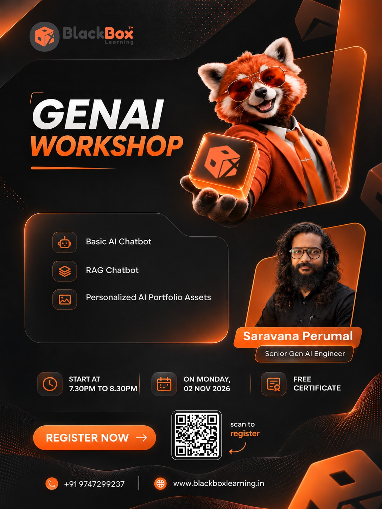

# GenAI Workshop: Build AI Chatbots with Groq

BlackBox Learning · Monday, 02 Nov 2026 · 7:30 PM to 8:30 PM
Instructor: Saravana Perumal, Senior Gen AI Engineer

## What we build

| Part | You build | Code | Notes |
|---|---|---|---|
| 1 | A basic AI chatbot that remembers the conversation | `chatbot.py` | [notes/1_chatbot.md](notes/1_chatbot.md) |
| 2 | A RAG chatbot that answers from your own documents | `rag_chatbot.py` | [notes/2_rag_chatbot.md](notes/2_rag_chatbot.md) |
| 3 | Personalized AI portfolio assets (LinkedIn, resume, GitHub README) | `portfolio_assets.py` | [notes/3_portfolio_assets.md](notes/3_portfolio_assets.md) |

## Before the workshop

1. Install **Python 3.10 or newer** from python.org (tick "Add Python to PATH").
2. Install **VS Code**.
3. Make a free account at **console.groq.com** and create an API key.

## Setup (Windows PowerShell)

    git clone https://github.com/saravanagithub14/AI-workshop-_2026_November-.git
    cd AI-workshop-_2026_November-
    python -m venv .venv
    .\.venv\Scripts\Activate.ps1
    pip install -r requirements.txt
    copy .env.example .env

Open `.env` and paste your Groq key after `GROQ_API_KEY=`.
No Git? Click the green **Code** button on this page, then **Download ZIP**.

Full setup steps and fixes for common errors are in [Part 1](notes/1_chatbot.md#2-one-time-setup).

## Run it

    python chatbot.py                  # Part 1 (add --web for a browser page)

    python rag_chatbot.py --index      # Part 2: save docs/ into the database
    python rag_chatbot.py              # (or --web)

    python portfolio_assets.py         # Part 3: writes files into portfolio/
    python portfolio_assets.py --web

Try in Part 2: "What did Asha build at her internship?" then "What is her favourite food?"
The second one should get "I don't have that in my documents."

## Make it yours

`docs/about_me.md` is a sample profile. Replace it with your own details, then run Part 2 and Part 3 again.

**Never share your `.env` file or post your API key online.**
